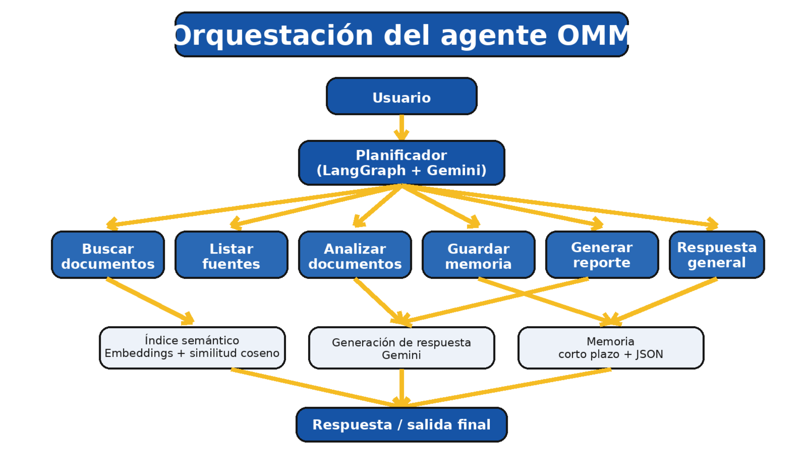

# Agente OMM – Hotel El Almendro

Proyecto desarrollado para la **Evaluación Parcial N°2 de Ingeniería de Soluciones con IA**.

El sistema corresponde a un agente funcional para apoyar la consulta y análisis de documentación del área de **Obras, Mantención y Mejoras (OMM)** de Hotel El Almendro.

## Integrantes

- Matías Loyola
- Matías Cisternas

**Sección:** 009D  
**Docente:** Michael Palomino

---

## Tecnologías utilizadas

- Python
- Google Colab
- Google Gemini
- `gemini-3.5-flash-lite`
- `gemini-embedding-2`
- LangGraph
- Pandas
- NumPy
- PyPDF
- OpenPyXL

---

## Funcionalidades

El agente puede:

- Consultar información desde archivos Excel y PDF.
- Realizar búsquedas semánticas mediante embeddings.
- Listar los documentos disponibles.
- Analizar información recuperada.
- Mantener memoria entre consultas.
- Guardar información indicada por el usuario.
- Generar reportes.
- Seleccionar automáticamente la herramienta necesaria según cada consulta.

---

## Arquitectura del agente

El flujo del sistema es:

**Usuario → Planificador → Herramienta → Contexto / Memoria → Gemini → Respuesta**

El planificador analiza la consulta y selecciona una de las herramientas disponibles:

- `buscar_documentos`
- `listar_documentos`
- `analizar_documentos`
- `guardar_memoria`
- `respuesta_general`
- `generar_reporte`

### Diagrama de orquestación



---

## Recuperación semántica

Los archivos cargados son procesados y divididos en fragmentos.

Para cada fragmento se genera un embedding utilizando:

```text
gemini-embedding-2
```

Los embeddings tienen una dimensión de:

```text
768
```

Cuando se realiza una consulta, el sistema genera su embedding y recupera los fragmentos con mayor similitud semántica.

Se utilizan hasta:

```text
TOP_K = 5
```

En los archivos Excel se mantienen los encabezados junto a los datos de cada fila para conservar el contexto de información como proveedor, producto, precio o comentario.

---

## Memoria

El agente utiliza dos tipos de memoria:

### Memoria de corto plazo

Mantiene los últimos turnos de la conversación para conservar el contexto entre preguntas.

### Memoria de largo plazo

Permite guardar información solicitada por el usuario y recuperarla posteriormente.

La memoria se almacena temporalmente en:

```text
/content/memoria_omm.json
```

---

## Formatos soportados

El sistema permite cargar:

```text
.pdf
.xlsx
.xlsm
```

Los documentos se cargan directamente desde Google Colab durante la ejecución.

---

## Cómo ejecutar el proyecto

### 1. Abrir el notebook

Abrir el archivo `.ipynb` disponible en este repositorio utilizando **Google Colab**.

### 2. Configurar la API Key

En Google Colab ingresar a:

**Secrets → Add new secret**

Crear el secreto:

```text
GOOGLE_API_KEY
```

y agregar una API Key válida de Google Gemini.

### 3. Ejecutar las celdas

Ejecutar el notebook en orden.

La primera sección instala automáticamente las dependencias necesarias:

```python
!pip install -q google-genai pypdf openpyxl langgraph
```

### 4. Cargar los documentos

Ejecutar la sección **Carga de archivos** y seleccionar los documentos desde el computador.

### 5. Procesar los archivos

El sistema:

1. Extrae la información.
2. Normaliza los datos.
3. Divide el contenido en fragmentos.
4. Genera embeddings.
5. Construye el índice semántico.
6. Deja la información disponible para el agente.

### 6. Realizar consultas

Se puede realizar una consulta mediante:

```python
preguntar_omm("Pregunta")
```

Ejemplo:

```python
preguntar_omm("¿Qué proveedores venden porcelanatos?")
```

También se puede utilizar:

```python
iniciar_chat()
```

para iniciar una conversación continua con el agente.

---

## Pruebas realizadas

Se probaron distintas consultas para comprobar que el planificador seleccionara correctamente cada herramienta.

| Caso | Herramienta seleccionada |
|---|---|
| Consulta de proveedores | `buscar_documentos` |
| Consulta de remodelación | `buscar_documentos` |
| Listado de documentos | `listar_documentos` |
| Análisis de información | `analizar_documentos` |
| Guardar información | `guardar_memoria` |
| Recuperar información guardada | `respuesta_general` |
| Generar un reporte | `generar_reporte` |

Los **7 casos de prueba seleccionaron correctamente la herramienta esperada**.

---

## Resultado de la ejecución

En la prueba final se utilizaron dos archivos Excel:

```text
PROVEEDORES REMODELACIONES.xlsx
REMODELACION CABAÑA SOL.xlsx
```

Resultados:

```text
Documentos cargados: 2
Fragmentos indexados: 16
Fuentes disponibles: 2
Turnos en memoria de corto plazo: 6
Datos en memoria persistente: 1
Reportes escritos: 1
Agente compilado: True
```

---

## Archivos del repositorio

```text
agente-omm-hotel-el-almendro/
│
├── Evaluación_Parcial_2__Hotel_El_Almendro.ipynb
│
├── README.md
│
└── docs/
    ├── diagrama_orquestacion.png
    └── Informe_EP2_Hotel_El_Almendro.pdf
```

---

## Documentación

El informe técnico de la evaluación se encuentra disponible en:

```text
docs/Informe_EP2_Hotel_El_Almendro.pdf
```

El diagrama de orquestación se encuentra en:

```text
docs/diagrama_orquestacion.png
```

---

**Asignatura:** Ingeniería de Soluciones con IA  
**Proyecto:** Sistema OMM – Hotel El Almendro  
**Integrantes:** Matías Loyola y Matías Cisternas
```
